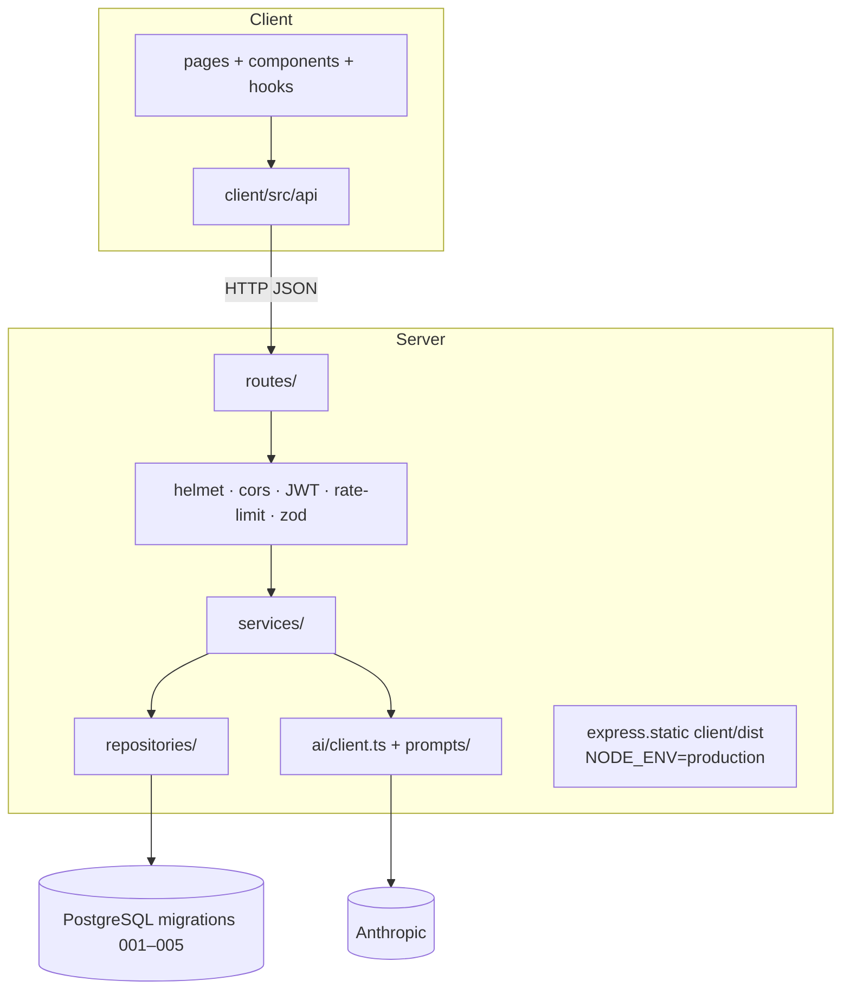
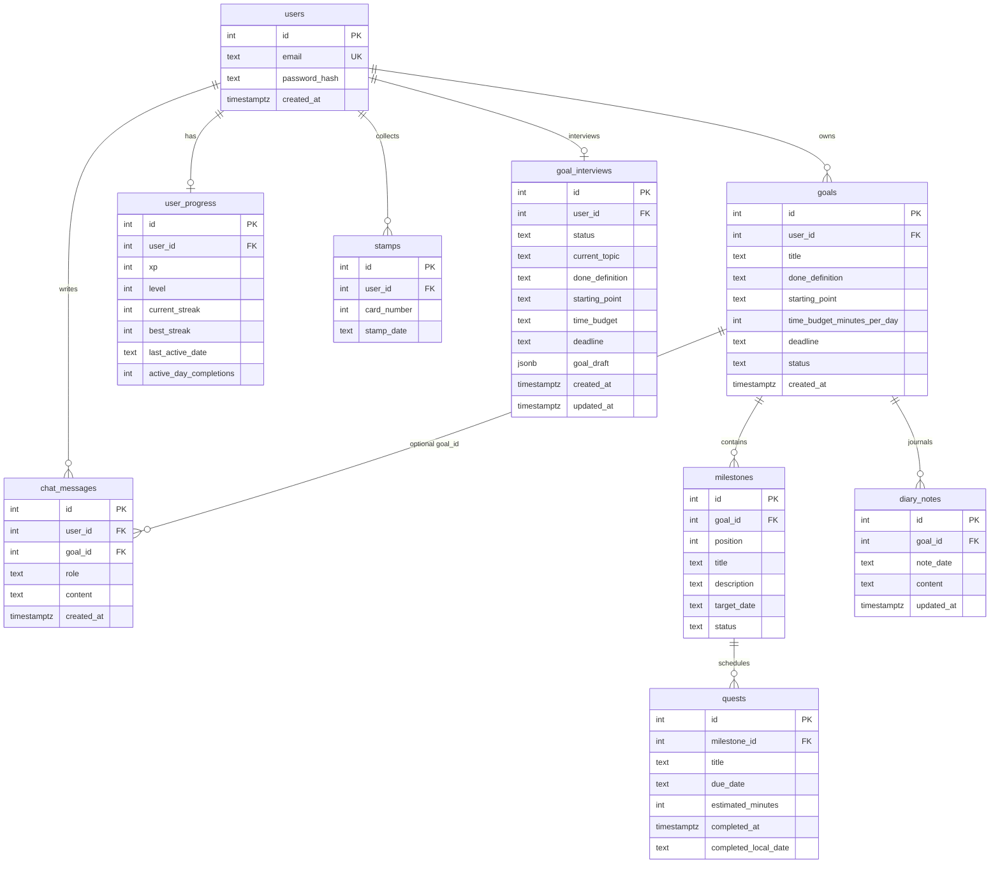

# Architecture

Companion to `AGENTS.md` §1.3. Stack: **React + Vite** SPA ↔ **Express 5** API ↔ **PostgreSQL** ↔ **Claude** (server-only).

## System context

```mermaid
flowchart LR
  User([Player]) --> SPA[React + Vite SPA<br/>Today / Map / Talk]
  SPA -->|Bearer JWT /api| API[Express 5 API<br/>routes → services → repos]
  API -.->|production static| SPA
  API --> PG[(PostgreSQL)]
  API -->|@anthropic-ai/sdk| Claude[Claude API<br/>ANTHROPIC_*]
  Shared[shared/src/schemas<br/>zod] -.-> SPA
  Shared -.-> API
```

## Request path



## Layering rules

| Layer | Owns | Does not |
| ----- | ---- | -------- |
| `client/` | UI, React Router, Bearer fetch | Claude keys, SQL, business rules |
| `server/src/routes/` | HTTP verbs, rate-limiters, zod parse, status codes | SQL, XP math, prompt text |
| `server/src/services/` | Domain logic, confirm-before-save, transactions | Express `req`/`res` |
| `server/src/repositories/` | Parameterized SQL | Auth / AI decisions |
| `server/src/ai/` | Claude gateway + prompts (plus echo fallback when enabled) | Direct DB writes of drafts as final rows |
| `shared/src/schemas/` | Request/response zod contracts | Runtime side effects |

**Confirm-before-save:** Goal interview answers and the pending goal proposal live in `goal_interviews` (`goal_draft` JSONB) until `POST /api/goals/new` confirms and writes to `goals`. Milestone, daily-quest, reschedule, and week-plan proposals are returned as transient previews from `*/draft` or `*/propose` endpoints and only persisted to `milestones` / `quests` when the user confirms via `*/confirm` (or `POST /api/goals/manual-plan`).

## API surface (summary)

| Mount | Purpose |
| ----- | ------- |
| `GET /api/health` | Liveness |
| `/api/auth` | Register / login → JWT |
| `/api/goals` | List, activate, delete, new-goal confirm, manual plan |
| `/api/milestones` | Draft → revise → confirm; stage complete |
| `/api/roadmap` | Active goal roadmap (start → milestones → goal) |
| `/api/quests` | Today (+ progress HUD), CRUD, quest draft, reschedule, week plan |
| `/api/chat` | Messages + interview restart |
| `/api/diary-notes` | Daily note get / upsert |

Full contract: [`openapi.yaml`](./openapi.yaml).

## Database schema (ER)

Derived from `server/src/db/migrations/` (`001`–`005`, tracked in `schema_migrations`). Calendar dates are `TEXT` as `YYYY-MM-DD`; timestamps are `TIMESTAMPTZ`.



**Constraints worth knowing**

- One **active** goal per user (`UNIQUE` partial index on `goals(user_id) WHERE status = 'active'`).
- `milestones (goal_id, position)` unique; statuses `upcoming` / `current` / `completed`.
- `stamps (user_id, stamp_date)` unique; `diary_notes (goal_id, note_date)` unique; one `goal_interviews` row per user.
- Cascade deletes: user → goals → milestones → quests; diary notes cascade with goals.

Narrative field notes: [`data-model.md`](./data-model.md).

## Optional rendered images

GitHub / most Markdown viewers render the Mermaid blocks above. Optional SVG exports (if present):

- [`diagrams/architecture.svg`](./diagrams/architecture.svg)
- [`diagrams/schema-er.svg`](./diagrams/schema-er.svg)
